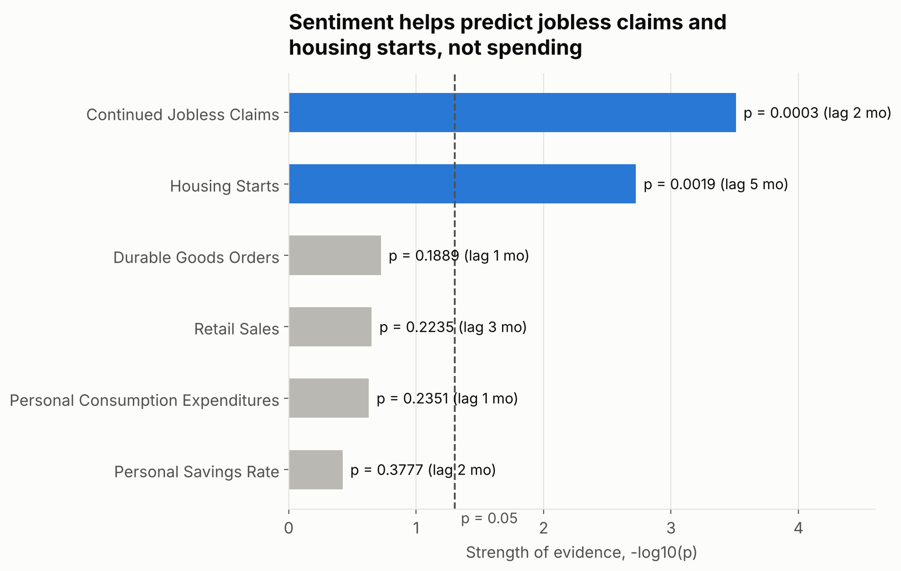
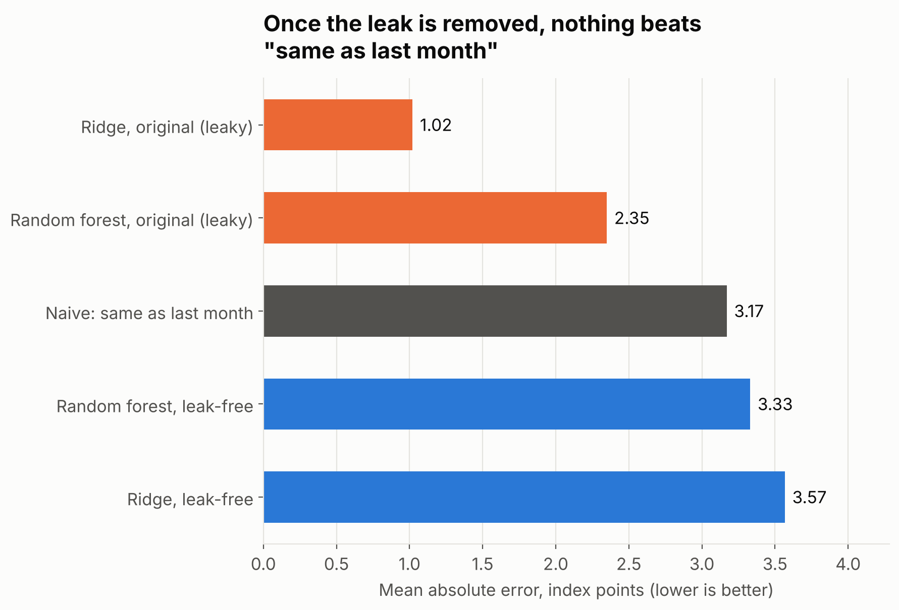
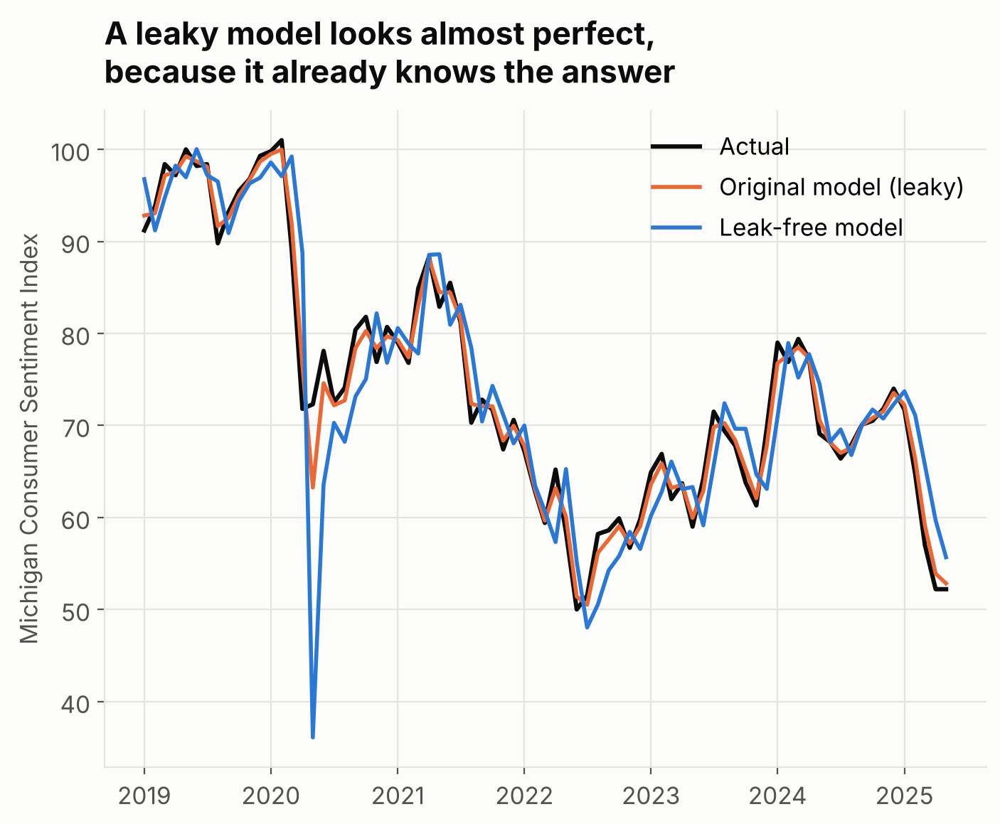

# Forecasting Consumer Sentiment with Federal Reserve Data, and Auditing the Model

**University of Michigan, Master of Applied Data Science capstone (2025).** Team project with Paul Stotts and Ali Alrubaiee. The original project repo is [gitpds/MADS_Capstone](https://github.com/gitpds/MADS_Capstone).

**Question:** Can public economic indicators from FRED (inflation, unemployment, rates, gas prices, housing, markets) explain and forecast the University of Michigan Consumer Sentiment Index, and does sentiment tell us anything about where the economy goes next?

This write-up covers what we built, what held up, and a post-graduation audit I ran that changed the headline result.

## What we built

- A pipeline that pulls 30+ monthly FRED series from 1990 to 2025 and builds lags, changes, rolling volatility, and spread features.
- Exploratory analysis: correlations, correlations by economic regime (1990s boom, pre-crisis, recovery, post-COVID), rolling correlations, and cross-correlation lead-lag timing.
- Granger causality tests of whether sentiment helps predict later economic activity.
- Rolling-origin (walk-forward) backtests of linear, random forest, SVR, and ensemble models.
- Scenario analysis (mild recession, inflation surge, strong recovery).

## What held up

**Sentiment helps predict jobless claims and housing starts, but not spending.** Past sentiment improved forecasts of continued jobless claims (p = 0.0003, 2-month lag) and housing starts (p = 0.002, 5-month lag). It did not improve forecasts of retail sales, consumer spending, durable goods orders, or the savings rate. So sentiment carries real information about the labor and housing markets, but it isn't a shortcut for predicting spending.



**Relationships change by regime.** Unemployment and sentiment were tightly linked in the 1990s boom (correlation -0.85), but the sign flipped after COVID (+0.29). The stock market tracked sentiment closely in the post-2009 recovery (+0.60) and inverted after COVID (-0.30). The fed funds rate went from irrelevant pre-crisis (-0.05) to a drag after COVID (-0.34). A model trained on one regime and deployed in another will be wrong in predictable ways.

## The audit: why a 0.989 R² was too good

The original model comparison reported a linear model with R² = 0.989 and 96% directional accuracy. When I revisited the project, I traced that result to **target leakage**. The most important feature, a 3-month moving average of sentiment, included the same month being predicted, so the model partly saw the answer.

I rebuilt the backtest with only information available before each forecast month (every feature lagged at least one month) and added the baseline every forecast should beat: "next month equals this month."

| Model (161 monthly forecasts, 2012–2025) | MAE | vs naive |
|---|---|---|
| Ridge, original (leaky) features | 1.02 | 68% better (not real) |
| Random forest, original (leaky) features | 2.35 | 26% better (not real) |
| **Naive: same as last month** | **3.17** | baseline |
| Random forest, leak-free | 3.33 | 5% worse |
| Ridge, leak-free | 3.57 | 13% worse |




**The honest conclusion:** at a one-month horizon, macro indicators don't add accuracy beyond sentiment's own persistence. The value is in the lead-lag and Granger findings and in longer-horizon, regime-aware analysis, not in a month-ahead point forecast.

**Why this matters for client work:** a model that looks great in a notebook and fails in production is the most expensive kind of model. Every model I deliver gets the same checks: features limited to what's known at prediction time, walk-forward validation, and a naive baseline it has to beat.

## Caveats

- The Granger tests ran on levels and took the best of six lags, so the p-values are optimistic. The jobless claims and housing results are strong enough to survive that, but the borderline ones aren't.
- Lead-lag correlations between trending series (CPI level, the S&P 500) are partly shared trend. Treat them as exploratory.
- One data label was corrected for this write-up: FRED series CC4WSA is continued jobless claims (4-week average), not consumer credit.

## Run the audit

```bash
pip install pandas numpy scikit-learn
python leakage_audit.py      # writes results/leakage_audit_results.csv
python make_figures.py       # writes figures/
```

`data/core_monthly.csv` is the monthly FRED extract from the original pipeline (1990–2025).

**Tools:** Python, pandas, statsmodels (VAR, Granger), scikit-learn, XGBoost, FRED API, matplotlib.
