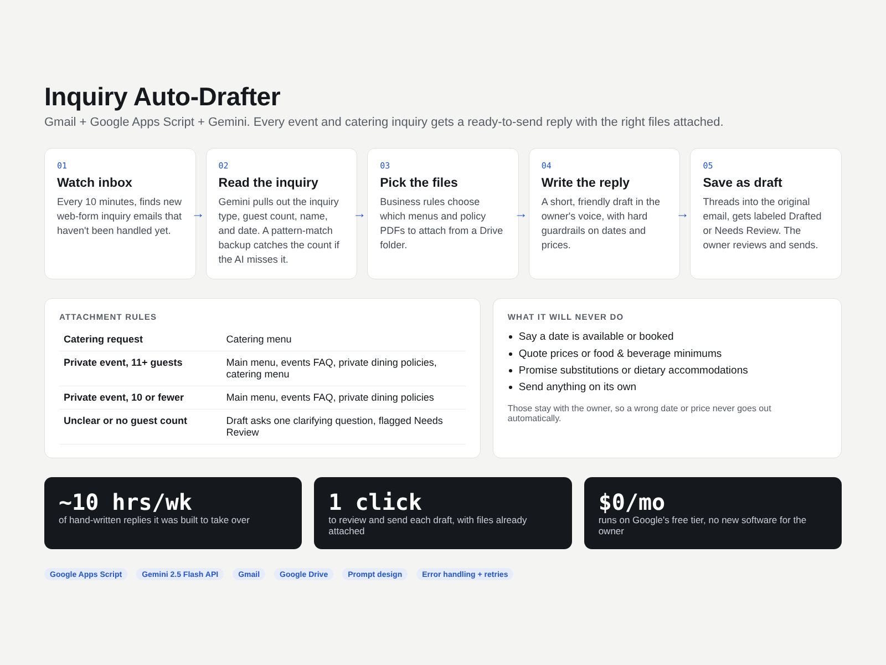

# Inquiry Auto-Drafter (Gmail + Apps Script + Gemini)

A small AI automation for a family-owned restaurant and catering business. Event and catering inquiries arrive as web-form notification emails, and the owner was spending about 10 hours a week writing replies by hand and digging up the right menus to attach.

Now every inquiry gets a ready-to-send draft, written in the owner's voice, with the right PDFs attached and threaded into the original email. The owner reviews it, adds the one or two things only a person should decide (date availability and pricing), and hits send.



## How it works

1. **Watch the inbox.** A time trigger runs every 10 minutes and finds new inquiry emails that haven't been labeled yet.
2. **Read the inquiry.** Gemini 2.5 Flash returns structured JSON: inquiry type, guest count, first name, event date. A regex fallback catches the guest count if the model misses it. That fallback was added after a real "25 people" inquiry slipped through the first version.
3. **Pick the attachments.** Plain business rules, not the AI, decide which menus and policy PDFs to pull from a Drive folder (catering, large private event, small private event).
4. **Write the reply.** A second Gemini call writes 60–100 words in a casual, friendly voice. Hard guardrails in the prompt keep it from confirming dates, quoting prices, or promising accommodations.
5. **Save as a draft in the same thread.** The form tool sets Reply-To to the customer, so a native `createDraftReply` addresses the customer and threads correctly. Anything uncertain (no rule matched, missing guest count, missing file, API error) is labeled `1Inquiries/NeedsReview` instead of `Drafted`.

## Design decisions

- **The AI writes, rules decide.** Attachment logic is deterministic code, so the owner can predict and change it.
- **It never sends.** Drafts only. The two things that cause real customer problems, a wrong date or a wrong price, are kept out of the AI's hands entirely.
- **It fails safe.** Errors and low-confidence cases go to a review label instead of disappearing, and API calls retry with backoff on rate limits.
- **Zero running cost.** It runs entirely on Google Workspace and the Gemini free tier, with no new software or subscriptions for the business.
- **Configurable.** Business name, voice, rules, file names, and guardrails all live in one `CONFIG` block at the top of the script.

## Files

```
Code.gs                 the full Apps Script (paste into script.google.com)
tests/test_helpers.js   unit tests for the routing rules, guest-count fallback, and JSON parsing (node tests/test_helpers.js)
workflow.png            one-page overview
```

## Setup (about 30 minutes)

1. Put the PDFs in a Drive folder and copy its ID.
2. Create a Gemini API key in Google AI Studio.
3. In Apps Script, paste `Code.gs`, then add the script properties `GEMINI_API_KEY` and `DRIVE_FOLDER_ID`.
4. Update `CONFIG` (search query, business name, rules, file names).
5. Run `setup()` once to create the labels and the 10-minute trigger, and approve the Gmail and Drive permissions.

The business name and form-tool address in this version are placeholders. The same pattern works for any business that gets form inquiries by email: contractors, venues, clinics, agencies, studios.

**Tools:** Google Apps Script, Gemini API, Gmail, Google Drive, prompt engineering, JavaScript.
