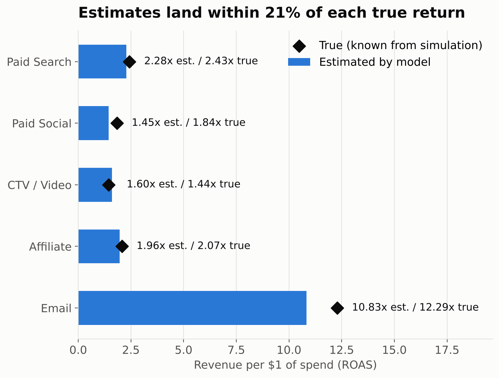
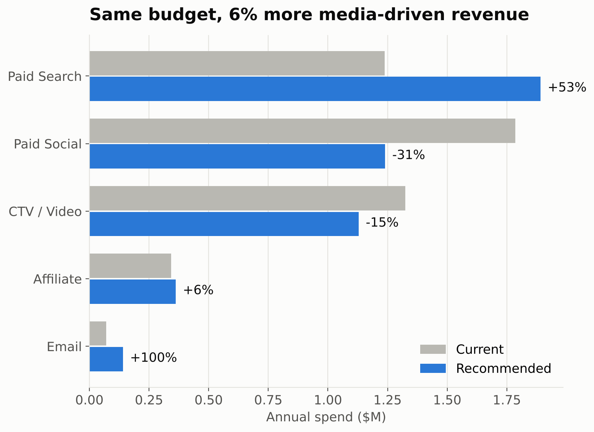

# Marketing Performance Case Study: Where Should the Next Dollar Go?

An end-to-end marketing analytics engagement for a fictional DTC brand (Ridgeline Supply Co., about $4.8M a year in media across five channels). It answers three questions leadership actually asks:

1. **Which channels are driving revenue?** A media mix model with adstock (carryover) and saturation (diminishing returns).
2. **How should we split next year's budget?** A constrained optimizer that reallocates spend at the same total budget.
3. **Which customers are worth keeping?** RFM segmentation, 12-month CLV by acquisition channel, and a repeat-purchase model for retention targeting.

The data is synthetic and generated inside the notebook, so the true channel effects are known. That makes it possible to check the model against ground truth, which you can never do with real data.

## Key results

| Question | Result |
|---|---|
| Can the MMM recover true channel returns? | Yes. Estimated ROAS lands within 21% of truth for every channel, and carryover rates come back within 0.06. |
| What does reallocation buy? | Moving about $546K a year from Paid Social into Paid Search, plus doubling Email, adds about 6% media-driven revenue (+$549K a year) at the same total spend. Checked against the true response curves: +6.2%. |
| Where is customer value concentrated? | Champions are 22% of customers and 47% of revenue. |
| Which channel brings the best customers? | Email-acquired customers are worth $359 over 12 months, vs $150 for Affiliate. |
| Can we target retention spend? | The repeat-purchase score (AUC 0.77) puts 44% of next quarter's repeat buyers in the top 20% of customers. |




## Methods

- **MMM:** geometric adstock and Hill saturation per channel, fit jointly with bounded nonlinear least squares (multi-start) alongside trend, seasonality, and holiday terms. In-sample R² 0.96, MAPE 1.5%.
- **Optimization:** SLSQP on steady-state response curves. Total spend is fixed and each channel stays within 50–200% of today's spend, so the recommendation is realistic to execute.
- **Segmentation:** RFM quintile scores mapped to six actionable segments.
- **CLV:** observed 12-month revenue per customer for cohorts with a full year of history.
- **Repeat-purchase model:** logistic regression vs gradient boosting on snapshot-time features only (no leakage), with a cumulative gains chart. The simpler model matched the complex one, so it's the one used.

In a real engagement I'd fit the MMM with Bayesian priors (PyMC-Marketing or Meridian), backtest it out of sample, and calibrate it against geo lift tests before moving real money.

## Run it

```bash
pip install -r requirements.txt
jupyter notebook marketing_performance_case_study.ipynb
```

Everything is seeded (seed 42), so every number above reproduces exactly. The generated data is written to `data/` and the charts to `figures/`.

## Repo contents

```
marketing_performance_case_study.ipynb   full analysis with outputs
data/                                    weekly spend and revenue, customers, orders (generated)
figures/                                 the charts used above
```

*All companies, customers, and figures are fictional.*
