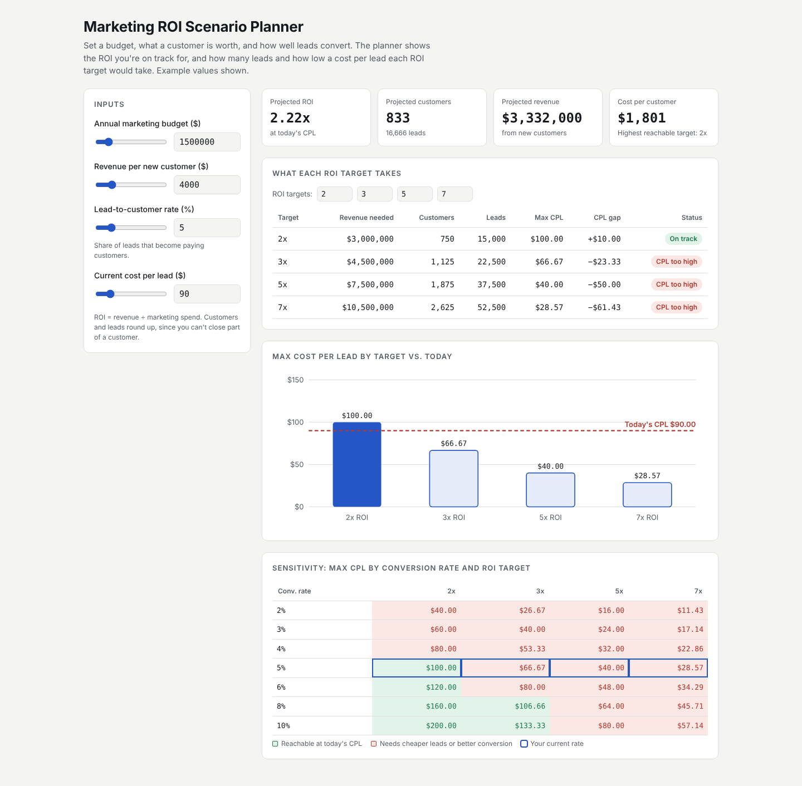

# Marketing ROI Scenario Planner

A live planning tool that answers the question every marketing budget meeting ends up on: **"What would it actually take to hit a 3:1 (or 5:1, or 7:1) return?"**

Plug in a budget, what a new customer is worth, the lead-to-customer conversion rate, and today's cost per lead. The planner shows:

- **Where you're headed now:** projected leads, customers, revenue, ROI, and cost per customer at today's CPL.
- **What each ROI target takes:** revenue, customers, and leads needed, the maximum CPL that still hits the target, and the gap vs. today, with an on-track or CPL-too-high flag.
- **Sensitivity:** max CPL across conversion rates and ROI targets, colored by what's reachable at today's CPL. It shows whether to work on cheaper leads or better conversion.

It comes in two versions with identical math:

| File | Use it for |
|---|---|
| `roi_planner.html` | A self-contained web app. Open it in any browser and drive it live on a screen share. |
| `ROI_Scenario_Planner.xlsx` | An Excel model with live formulas (Inputs, Scenarios, Sensitivity tabs, plus a chart), for finance teams who want to audit every cell. |

## Example (illustrative inputs)

$1.5M budget, $4,000 per customer, 5% conversion, $90 CPL:

- On track for **2.22x ROI** (16,666 leads → 833 customers → $3.33M).
- **2x** needs a CPL of $100 or less, so it's on track.
- **3x** needs 22,500 leads at **$66.67** or less. That's $23 cheaper per lead than today, or the same $90 CPL with conversion raised from 5% to about 6.8%.

## Design choices

- **Two-step rounding** (revenue → customers → leads, each rounded up) is used everywhere. An early version rounded once in the sensitivity grid and twice in the scenario table, which produced small mismatches between tabs. Consistency is the whole point of a planning tool, so the grid was rebuilt to match.
- **Inputs, formulas, and links are color-coded** in the workbook (blue, black, green), and every assumption sits in its own labeled cell.
- **ROI is gross revenue / spend**, stated on the page, so nobody confuses it with margin ROI.

The original version was built for a leadership budget conversation. This portfolio version uses generic example inputs, and no client data is included.

**Tools:** JavaScript (no dependencies), SVG, Excel (openpyxl-built, formula-driven), Python.
