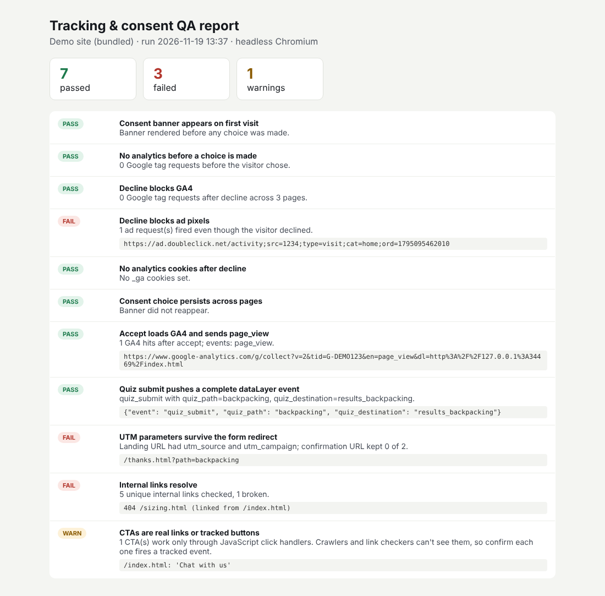

# Tracking & Consent QA Suite

An automated audit that drives a real browser through a website, records every network request, and checks that analytics and ad tags respect what the visitor chose in the cookie banner. It also checks that conversion events and campaign parameters actually make it into your data.

Most "tracking is broken" problems are invisible on the page. The site looks fine, the form works, and the numbers quietly drift: an ad pixel fires for people who declined (a privacy liability), UTMs get dropped on a redirect (so conversions show up as "direct"), or a button only works through JavaScript and was never tagged. This suite catches those in about 30 seconds and produces a report you can hand to a dev team or a compliance reviewer.



## What it checks

| Area | Check |
|---|---|
| Consent | Banner appears on first visit; no analytics fire before a choice; the choice persists across pages |
| Decline path | No GA4/Google tag requests, no ad pixels, no `_ga` cookies across a multi-page session |
| Accept path | GA4 loads and sends `page_view` |
| Conversions | The form submit pushes a `dataLayer` event with every required parameter |
| Attribution | UTM parameters survive the form redirect to the confirmation page |
| Site health | Every internal link resolves; CTAs that only work through JS click handlers are flagged for tagging review |

## Demo results

The bundled demo site has three planted defects, the same kinds I've found on production sites. The suite catches all three:

1. **An ad pixel fires after the visitor declines.** It was added outside the consent manager.
2. **UTMs are dropped** when the quiz redirects to the confirmation page, so the conversion loses its campaign.
3. **A broken link** (404) on a homepage CTA.

It also warns on a "Chat with us" button that only works through JavaScript, which needs a tracked event to show up in analytics.

## Run it

```bash
pip install -r requirements.txt
playwright install chromium

python tracking_audit.py                                          # demo site, fully offline
python tracking_audit.py --base-url https://yoursite.com --pages / /about /contact --quiz /get-started
```

The output is `reports/report.html` (shareable) and `reports/report.json` (for CI or tracking results over time). Selectors for OneTrust and Cookiebot are built in, and other consent managers take a one-line change. Add tag families (Meta, TikTok, LinkedIn) in the `TAGS` dictionary.

## How it works

- **Each visitor is a fresh browser context**, so cookies and consent state never leak between the decline, accept, and conversion runs.
- **Every request is logged** and matched against tag-family patterns. For the demo, Google and ad endpoints are intercepted and stubbed, so the suite runs with no network and never sends fake hits to a real property.
- **dataLayer pushes are captured** through an init script that mirrors them into `sessionStorage`, so the event can still be inspected after the page redirects.

The original version was built to QA a high-traffic healthcare lead-gen site, where it ran 750+ checks across quiz paths, cookie consent, and provider-search flows. This portfolio version is a clean rebuild against a fictional demo site.

**Tools:** Python, Playwright (Chromium), GA4 / Google tag, consent management platforms, HTML reporting.
